  

  

My pet grows with my real contributions: a 13-week streak fills its meter, a year of steady work makes it glow, and two quiet weeks put it to sleep.

## 💻 Tech Stack

...all your badge lines exactly as they are now...

  

